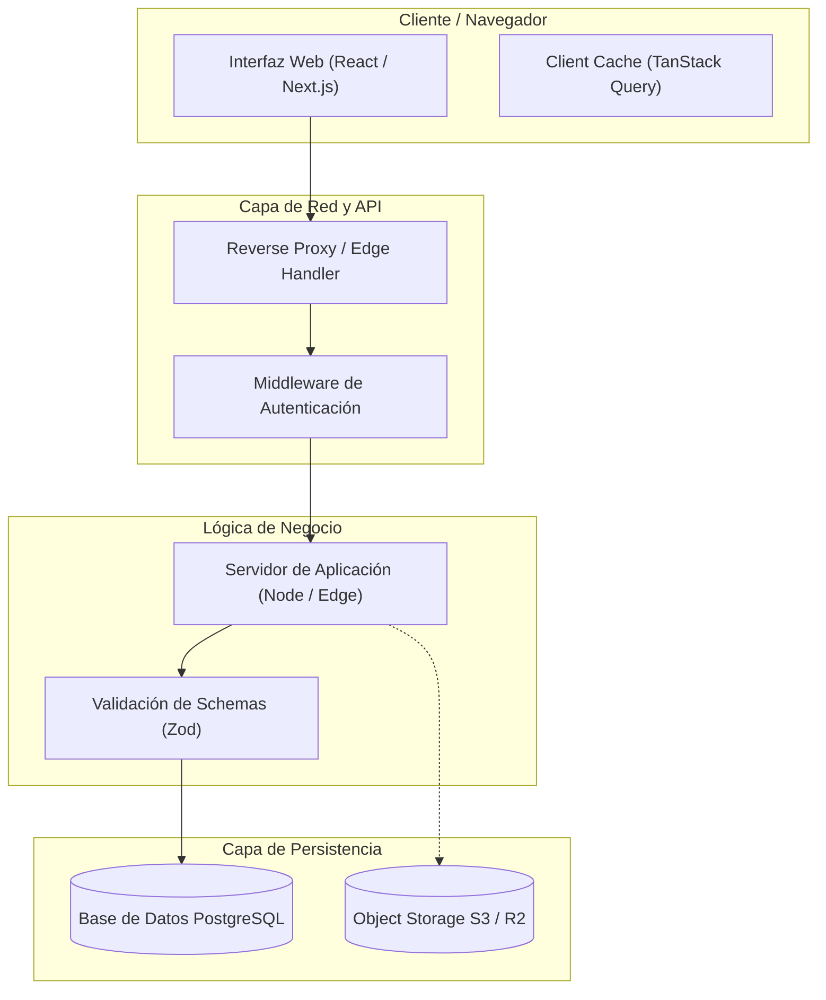

# ARCHITECTURE — [Nombre del Sistema]

> **Estado:** `borrador` · **Gate:** G4 · **Última actualización:** [AAAA-MM-DD]  
> **Aprobado por:** [Nombre del Usuario] · **Fecha de aprobación:** [AAAA-MM-DD]

---

## 1. Diagrama de Arquitectura del Sistema (Mermaid)



---

## 2. Stack Tecnológico Fijado

| Capa | Tecnología Seleccionada | Versión Fijada | Justificación Técnica |
|---|---|---|---|
| **Lenguaje** | TypeScript | `^5.x` | Tipado estricto extremo (`noImplicitAny: true`). |
| **Framework Web** | Next.js / Vite + React | `^15.x / ^19.x` | Soporte Server Components / Renderizado óptimo. |
| **Estilos / UI** | Tailwind CSS v4 + Radix UI | Última estable | Utilidades atómicas sin dependencias de runtime. |
| **Base de Datos** | PostgreSQL (Neon / Supabase) | PostgreSQL 16+ | Integridad relacional, soporte JSONB y RLS nativo. |
| **ORM / Query Builder** | Prisma o Drizzle ORM | Última estable | Type-safety de punta a punta entre base de datos y UI. |
| **Validación de Datos** | Zod | `^3.x` | Single source of truth para esquemas de entrada/salida. |
| **Gestor de Paquetes**| pnpm / npm | `lockfile` frozen | Builds reproducibles y deterministas. |

---

## 3. Seguridad, Autenticación y Autorización

* **Flujo de Autenticación:** Sesiones basadas en cookies HTTP-Only, Secure y SameSite=Lax.
* **Validación en Servidor:** **Nunca** confiar en autorizaciones evaluadas únicamente en el cliente. Todo endpoint, server action o mutación verifica el token y rol en el backend.
* **Manejo de Secretos:**
  * Variables de entorno públicas con prefijo explícito (ej. `NEXT_PUBLIC_`).
  * Claves de servicio privadas (`DATABASE_URL`, `AUTH_SECRET`) accesibles únicamente en runtime del servidor.
  * Archivo `.env.example` versionado sin valores reales.

---

## 4. Estructura Canónica de Directorios

```text
src/
├── app/                  # Rutas, layouts y páginas (App Router)
│   ├── (auth)/           # Grupo de rutas de autenticación
│   ├── (dashboard)/      # Grupo de rutas protegidas
│   └── api/              # Endpoints de API / Webhooks
├── components/           # Componentes modulares
│   ├── ui/               # Componentes base del Design System (Button, Input, Modal)
│   └── feedback/         # Estados de loading, error y empty
├── lib/                  # Utilidades y clientes de infraestructura
│   ├── db.ts             # Instancia de conexión a la base de datos
│   └── auth.ts           # Configuración del proveedor de autenticación
├── modules/              # Lógica de dominio por slices
│   └── [feature]/        # Servicios, acciones de servidor, queries y schemas
└── types/                # Definiciones de tipos globales de TypeScript
```

---

## 5. Estrategia de Testing y Verificación

1. **Typechecking y Linting:** `tsc --noEmit` y `eslint .` en cada slice. Cero errores tolerados.
2. **Pruebas Unitarias e Integración:** Vitest para lógica de negocio, validaciones de esquema y utilidades.
3. **Pruebas E2E (Críticas):** Playwright verificando los 3 flujos clave (Auth, Creación, Listado).

---

## 6. Matriz de Riesgos Técnicos y Mitigaciones

| Riesgo Técnico | Probabilidad | Impacto | Estrategia de Mitigación |
|---|---|---|---|
| Latencia en llamadas a APIs de terceros | Media | Alto | Timeout agresivo (5s) + Fallback degradado amigable. |
| Inconsistencia de concurrencia en escritura | Baja | Crítico | Transacciones ACID a nivel de base de datos (`tx.run`). |
| Agotamiento de pool de conexiones | Media | Alto | Connection pooler (PgBouncer o Neon pooling) activado. |
