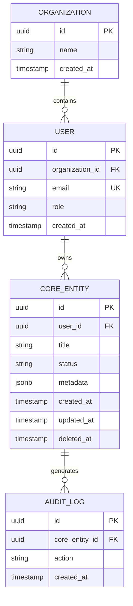

# DATA-MODEL — [Nombre del Sistema]

> **Estado:** `borrador` · **Gate:** G2 · **Última actualización:** [AAAA-MM-DD]  
> **Aprobado por:** [Nombre del Usuario] · **Fecha de aprobación:** [AAAA-MM-DD]

---

## 1. Diagrama Entidad-Relación (Mermaid)

---

## 2. Definición Detallada de Entidades

### Entidad Principal: `[CORE_ENTITY]`
* **Descripción:** Representa el recurso fundamental de la aplicación.
* **Identificador:** UUID v7 (`id`) para garantizar orden cronológico y unicidad distribuida.
* **Campos Relevantes:**
  * `id`: `UUID` (PK)
  * `organization_id`: `UUID` (FK referenciando Organización)
  * `user_id`: `UUID` (FK referenciando Usuario creador)
  * `title`: `VARCHAR(255)` (No nulo)
  * `status`: `ENUM('draft', 'active', 'archived')`
  * `created_at` / `updated_at`: `TIMESTAMPTZ`
  * `deleted_at`: `TIMESTAMPTZ` (Permite borrado blando / Soft Delete)

---

## 3. Matriz de Autorización y Permisos (RBAC / RLS)

| Entidad | Acción | Rol: Lector | Rol: Editor | Rol: Dueño / Admin |
|---|---|---|---|---|
| **Perfil Propio** | Ver / Editar | Sí / Sí | Sí / Sí | Sí / Sí |
| **Entidad Core** | Listar / Ver | Solo autorizadas | Todas de la Org | Todas de la Org |
| **Entidad Core** | Crear | No | Sí | Sí |
| **Entidad Core** | Modificar | No | Solo propias | Todas de la Org |
| **Entidad Core** | Borrar | No | No | Sí (Soft Delete) |
| **Configuración** | Acceso | No | No | Sí |

---

## 4. Protección de Datos Sensibles y PII

* **Datos Identificables (PII):** [Ej. Nombres, emails, teléfonos] → Cifrado en tránsito (TLS 1.3) y en reposo (AES-256).
* **Credenciales / Secretos:** Hasheados mediante algoritmos seguros (Argon2id o bcrypt con costo adaptativo); nunca persistidos en texto plano.
* **Aislamiento Multi-inquilino (si aplica):** Filtrado obligatorio por `organization_id` validado a nivel de base de datos mediante Row Level Security (RLS).

---

## 5. Ciclo de Vida del Dato y Retención

* **Estrategia de Borrado:** Soft delete vía columna `deleted_at`. Los datos marcados no se eliminan físicamente de inmediato para permitir recuperación ante error humano.
* **Purga Definitiva:** Política de retención que purga registros en borrado blando tras [X días / 30 días].
* **Exportabilidad:** Capacidad para que el usuario descargue sus datos estructurados en formato JSON o CSV estándar.

---

## 6. Reglas de Negocio e Invariantes del Modelo

1. *Invariante 1:* Ninguna entidad core puede existir sin un usuario y organización válidos asignados.
2. *Invariante 2:* El cambio de estado de `draft` a `active` requiere que los campos obligatorios `[A, B, C]` estén completos.
3. *Invariante 3:* Un usuario con rol Lector no puede ejecutar mutaciones de base de datos bajo ninguna circunstancia.
