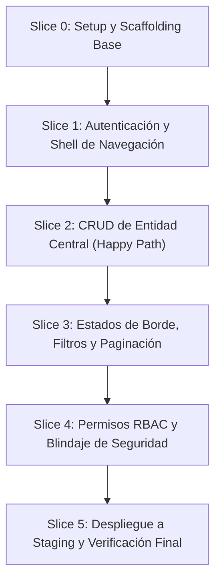

# ROADMAP — Plan de Slices Verticales

> **Estado:** `borrador` · **Gate:** G1/G4 · **Última actualización:** [AAAA-MM-DD]  
> **Aprobado por:** [Nombre del Usuario] · **Fecha de aprobación:** [AAAA-MM-DD]

---

## 1. Filosofía de Entrega por Slices Verticales

Cada entrega en el Roadmap corresponde a una rebanada vertical completa y demostrable de extremo a extremo:
$$\text{Ruta / URL} \longrightarrow \text{Componente UI} \longrightarrow \text{Acción de Servidor / API} \longrightarrow \text{Persistencia DB} \longrightarrow \text{Pruebas}$$

Nunca se construyen "capas horizontales aisladas" (ej. hacer todas las tablas de base de datos sin pantallas, o maquetar 10 páginas sin lógica).

---

## 2. Secuencia de Slices del MVP (Gate G6)

---

## 3. Detalle de Slices del MVP

### Slice 0: Scaffolding y Sistema Base
* **Objetivo:** Repositorio inicial configurado con Tailwind v4, linter, TypeScript estricto y conexión a DB.
* **Archivos Involucrados:** `package.json`, `tsconfig.json`, `src/lib/db.ts`, `globals.css`.
* **Criterio de Cierre:** `npm run build` y `npm run typecheck` en verde.

### Slice 1: Autenticación y Shell de Navegación
* **Objetivo:** Registro, inicio de sesión y layout base protegido con sidebar/navbar.
* **Criterio de Cierre:** Un usuario puede crear cuenta, iniciar sesión y ver su dashboard vacío.

### Slice 2: Flujo Core de la Entidad Central
* **Objetivo:** Formulario de alta y guardado exitoso de la entidad principal del sistema.
* **Criterio de Cierre:** El registro persiste en PostgreSQL y se visualiza en la tabla principal.

### Slice 3: Robustez de UI y Filtros
* **Objetivo:** Implementación de loading skeletons, empty states amigables, búsqueda y paginación.
* **Criterio de Cierre:** Experiencia fluida con 0 registros y con 100 registros de prueba.

### Slice 4: Autorización y Control de Acceso
* **Objetivo:** Aplicación de políticas de rol (Lector no puede editar ni borrar).
* **Criterio de Cierre:** Pruebas unitarias confirmando el rechazo de mutaciones no autorizadas.

---

## 4. Backlog Post-MVP (Versiones Posteriores)
- [ ] Exportación avanzada de reportes en PDF y Excel.
- [ ] Webhooks para integraciones externas.
- [ ] Módulo de facturación automatizada mediante Stripe.
