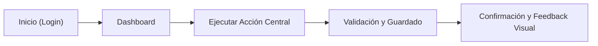

# SPEC — [Nombre del Sistema]

> **Estado:** `borrador` · **Gate:** G0/G1 · **Última actualización:** [AAAA-MM-DD]  
> **Aprobado por:** [Nombre del Usuario] · **Fecha de aprobación:** [AAAA-MM-DD]

---

## 1. Declaración del Problema

[Describe qué fricción, dolor o ineficiencia existe hoy en 2–3 frases concisas. No menciones tecnologías ni soluciones en esta sección.]

---

## 2. Usuarios y Matriz de Roles

| Rol | Descripción del Usuario | Frecuencia de Uso | Nivel Técnico | Necesidad Crítica |
|---|---|---|---|---|
| **Usuario Final** | [Ej. Empleado operativo] | Diaria (múltiples veces) | Básico | Cargar registros en menos de 30 segundos. |
| **Administrador** | [Ej. Líder de área] | Semanal | Intermedio | Monitorear métricas y configurar accesos. |

---

## 3. Propuesta de Valor Única

> *"Para **[usuario objetivo]** que enfrenta **[problema/situación]**, el sistema **[beneficio principal]**, a diferencia de **[método actual o competencia]**."*

---

## 4. Acción Central (El Verbo Clave)

[El verbo operativo y medible que justifica la existencia del producto. Ej.: *"Conciliar una factura"*, *"Publicar un inmueble"*, *"Generar un presupuesto en PDF"*, *"Asignar un turno médico"*.]

---

## 5. Alcance del MVP (3 a 5 Features Indispensables)

| ID | Feature | Valor Aportado | Criterio de Finalización ("Done") |
|---|---|---|---|
| **F-01** | [Ej. Autenticación y Perfil] | Seguridad y personalización | Registro, login, recuperación y persistencia de sesión segura. |
| **F-02** | [Ej. Creación de Registro Core] | Acción central del sistema | Formulario validado con persistencia y confirmación visual. |
| **F-03** | [Ej. Panel de Visualización] | Consulta y trazabilidad | Tabla filtrable, paginada y con estados vacío/cargando. |

---

## 6. Fuera de Alcance Explícito (No en MVP)

- [ ] **[Feature excluida 1]:** Motivo: [Ej. Complejidad técnica innecesaria en etapa de validación].
- [ ] **[Feature excluida 2]:** Motivo: [Ej. Pospuesto para versión 2.0 tras feedback de usuarios reales].

---

## 7. Flujo de Usuario Principal

1. **Paso 1:** El usuario ingresa a la vista principal y selecciona la acción core.
2. **Paso 2:** Completa los campos obligatorios con validación reactiva en tiempo real.
3. **Paso 3:** Envía la información; el sistema confirma el éxito y actualiza la lista inmediatamente.

---

## 8. Métrica de Éxito a 90 Días

| Métrica Clave (KPI) | Objetivo Numérico | Método de Medición |
|---|---|---|
| [Ej. Tasa de adopción] | [Ej. 80% de usuarios completan su primera acción en < 3 min] | Evento analítico o registro en base de datos |

---

## 9. Restricciones del Proyecto

* **Tiempo / Fecha límite:** [Fecha o "Sin fecha estricta, MVP en 4 semanas"]
* **Presupuesto / Infraestructura:** [Ej. Tier gratuito de Cloud / $XX USD al mes]
* **Cumplimiento legal / Privacidad:** [Ej. RGPD / Protección de datos de clientes]

---

## 10. Registro de Supuestos de Producto

| ID | Supuesto | Impacto si es Falso | Disparador de Validación |
|---|---|---|---|
| **S-01** | [Premisa asumida] | [Riesgo asociado] | [Momento exacto en que se valida] |
